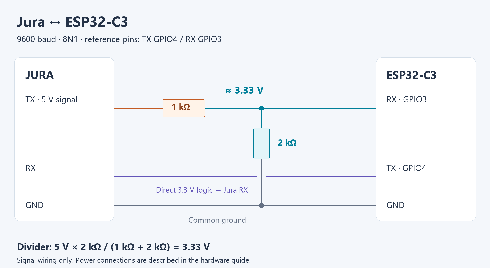

# Jura Native for ESPHome — V2

Monitor and prepare Jura drinks through Home Assistant using ESPHome's native
API. MQTT is not required. The `main` branch contains both `jura_native` and legacy `jura`;
its current component version is recorded in [VERSION](VERSION).
Pinning to a [component release](docs/releases.md) is optional: use `ref: main`
to follow stable development, `ref: dev` for development features, or a release
tag for a fixed version. Component and card releases are independent.

> **Unofficial project — use at your own risk.** This independent community
> project is not affiliated with, endorsed by, sponsored by, or supported by
> JURA Elektroapparate AG. Installation and use may cause equipment damage,
> unintended operation, hot-liquid discharge, or injury. Read the
> [full disclaimer](docs/disclaimer.md) before installing or using it. The software
> is provided without warranty under the [MIT License](LICENSE).

## Features

- **Model identification:** automatic EF detection with 75 bundled model profiles.
- **Live monitoring:** machine status, model-specific TF alerts, current drink,
  TV stage descriptions, overall progress and available stage quantities.
- **Counters:** profile-labelled AT product counts and maintenance readings.
- **Saved recipes:** selecting a drink reads its saved settings into native HA
  controls, with an explicit profile-default fallback when a read fails.
- **One-shot adjustments:** strength, temperature, water, milk duration and other
  supported settings apply to the next accepted Brew request; the machine's
  saved recipe is never overwritten.
- **Native API actions:** `brew_drink`, `brew_custom` and `brew_selected`.
  Named/custom actions use freshly read saved settings as their defaults.
- **Nonblocking UART:** serialised transactions, bounded reception, readiness
  checks, timeout recovery and no automatic brew retry.
- **Optional Cool Control receiver:** a separate `jura_coolcontrol` component
  for the existing observed milk-level/temperature frame format.

The reference machine is an **E8 / EF533M V02.09 on ESP32-C3 with ESP-IDF**.
A profile being present does not mean that its firmware, handshake or every
feature has been tested. See [validation status](docs/testing.md).
Legacy raw-register interpretations are **unverified**; use the profile-based
AT counters as the primary named readings and see [diagnostics](docs/diagnostics.md).

## Hardware and connectivity

The reference E8 uses a UART connection at **9600 baud, 8N1**, with ESP32-C3
**GPIO4 TX**, **GPIO3 RX** and a shared ground. Cross the data directions:
Jura TX goes to ESP RX; ESP TX goes to Jura RX.

For the Jura's **5 V TX signal**, use a **1 kΩ / 2 kΩ voltage divider** before
GPIO3. The junction supplies approximately **3.33 V** when Jura TX is high.
The ESP's 3.3 V GPIO4 TX can drive Jura RX directly on the reference E8 interface.



See [hardware and wiring](docs/hardware.md) for the connection table, original
connector reference, power guidance and matching YAML. The divider is for the
UART signal; it does not power the ESP. ESP32-C3 GPIO inputs must not be connected
directly to a 5 V signal.

## In Home Assistant

Native ESPHome entities provide controls and monitoring without MQTT. These
examples show the standard controls and a possible monitoring layout:

| Native controls — user screenshot | Monitoring — illustration |
| --- | --- |
|  |  |

The controls screenshot was taken during earlier testing, before saved-recipe
synchronisation; its values are examples. The monitoring illustration combines
E8 test readings and is not a live or simultaneous screenshot. Entity availability
depends on the detected profile. See [card integration](docs/home-assistant.md).

## Jura Graphical Card

The optional **[Jura Graphical Card](docs/card.md)** adds illustrated drink
selection, machine-saved recipes, native progress and friendly machine alerts.
It supports a separate Cool Control and runs entirely in the HA dashboard.
[Custom recipes and optional hold-to-brew](docs/card-recipes.md) let you prepare
personal drinks from machine-saved bases.


See **[HACS/manual installation and configuration](docs/card.md)**. The card
bundle is `dist/jura-native-card.js`; its version is tracked in `card/VERSION`,
independently of the ESPHome component. HACS availability starts after the card
is merged from `dev` to `main` and its release is published.

## Get started

The repository provides both **`jura_native` (V2)** and **`jura` (legacy)** under
`components/`. Existing legacy users can keep `components: [jura]` and their
`jura:` configuration on `main`; migration is optional.
See [continuing with the legacy component](docs/migration.md#keep-using-the-legacy-component).
The following setup is for the new native component.

Merge this source into your existing device YAML:

```yaml
external_components:
  - source:
      type: git
      url: https://github.com/tiaanv/jura
      ref: components-v1.0.0
    refresh: 0s
    components: [jura_native]
```

Follow the [configuration guide](docs/configuration.md), or adapt the complete
[E8 example](examples/e8.yaml). Retain your device name, Wi-Fi, native API
encryption, OTA configuration and secrets. The examples contain placeholders.
Only one component may consume the Jura UART.

1. Compile/upload and wait for **Jura Connected** and sensible ready/alert states.
2. Select **Jura Drink** and wait for **Jura Recipe Loading** to turn off.
3. Check **Jura Recipe Source** (`Machine` or `Profile defaults`).
4. Adjust supported settings and press **Jura Brew**.

**Reset Recipe** discards HA edits and reloads the selected drink. Edits are
consumed when a Brew request is accepted into the queue; rejected requests
retain them. See [saved recipes](docs/saved-recipes.md) for the exact behaviour.

## Home Assistant actions

The [complete E8 YAML](examples/e8.yaml) defines the actions. Existing devices
that already define them need only the updated component implementation.

Saved Flat White on a device named `jura-e8`:

```yaml
action: esphome.jura_e8_brew_drink
data:
  drink: "1 Flat White"
```

For a 60 ml water override while keeping the other saved settings, use the
[custom Flat White example](docs/home-assistant.md#custom-flat-white).
[Action examples](examples/ha-actions.yaml) must be run individually; they are
not an ESPHome device configuration.

## Guides

| Guide | Contents |
| --- | --- |
| [Hardware and wiring](docs/hardware.md) | Connector reference, RX voltage divider, common ground and power |
| [Configuration](docs/configuration.md) | Installation, wiring example, options, native controls, Cool Control |
| [Saved recipes](docs/saved-recipes.md) | Loading, fallback, one-shot edits, API preparation and cancellation |
| [Graphical card](docs/card.md) | HACS/manual installation, configuration and live screenshots |
| [Home Assistant](docs/home-assistant.md) | Action YAML, native entity contract and card integration |
| [Diagnostics](docs/diagnostics.md) | Espresso probe, startup troubleshooting, stale state, raw registers |
| [Migration](docs/migration.md) | Replacing the old `jura` component and updating an existing V2 device |
| [Profiles](docs/profiles/README.md) | Model index and readable export of the full bundled database |
| [Development and testing](docs/testing.md) | Host tests, schema checks, compiler checks and hardware evidence |
| [Architecture](docs/architecture.md) | Transport, controller, profiles and native entities |
| [Sources and licensing](docs/sources.md) | Upstream attribution, protocol references and data limitations |

## Repository layout

```text
components/   Installable jura_native, legacy jura and jura_coolcontrol components
examples/     Current ESPHome configurations and HA action examples
docs/         Current guides and readable profile exports
tests/        Portable regression tests and ESPHome schema validation
card/         Dashboard card source, examples, tests and build script
dist/         Standalone HACS dashboard bundle
tools/        Profile export, documentation checks and source packaging
legacy/       Historical examples, original README and register documentation
```

The legacy component remains installable at [components/jura](components/jura),
alongside **jura_native** and **jura_coolcontrol**. It uses non-blocking UART with
`queue_command()` buttons and framework-independent C++ for ESP32 ESP-IDF,
ESP32 Arduino and ESP8266 Arduino. See the [legacy guide](legacy/README.md),
[C3/IDF example](examples/legacy-e8.yaml) and
[button migration](docs/migration.md#keep-using-the-legacy-component).
See the [change log](CHANGELOG.md).

## Support

Enjoying the project? [Buy me a beer 🍺](https://ko-fi.com/tiaanvee).
Always appreciated, never expected.

## Credits and licence

The model database, AT cipher reference and progress glossary build on
[harryzz/jura-uart-esphome](https://github.com/harryzz/jura-uart-esphome).
Protocol work also draws on the sources listed in [sources](docs/sources.md).
The historical component credits are preserved in the legacy archive.

MIT licensed; see [LICENSE](LICENSE) and the retained
[harryzz notice](components/jura_native/LICENSE.harryzz).

### Older firmware recipe reads and stage progress

Set `read_saved_recipes: false` under `jura_native` when firmware does not answer
saved-settings requests. Native/API recipes then start from profile defaults,
with one-shot overrides still supported. See [saved recipes](docs/saved-recipes.md).
`Jura Stage Progress` supplies dispensing-stage percentage separately from overall
progress; see [HA entity semantics](docs/home-assistant.md#dispensing-stage-progress).
The EF533 raw Brew Movements label is now Legacy Coffee Rinse Count (unverified).
