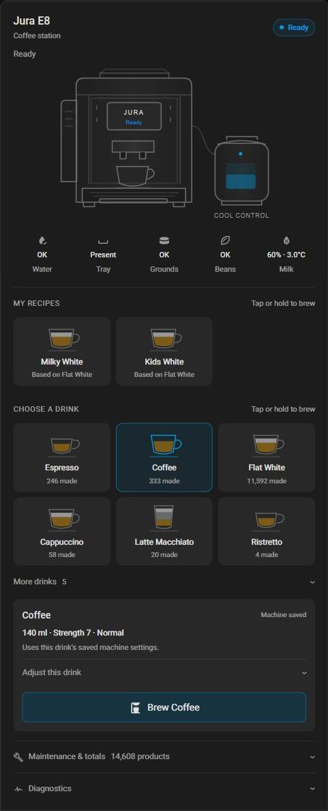

# Custom recipes and hold-to-brew

These features require card **2.1.2** or later. The card's [installation guide](card.md)
explains HACS/manual installation, entity prefixes and optional Cool Control.

## Custom recipes

Define personal recipes in the card's YAML. **My Recipes** appears above the
standard drinks only when configured. Tiles use the base drink's cup artwork.

```yaml
type: custom:jura-native-card
name: Jura E8
entity_prefix: jura_e8
coolcontrol: false
recipes:
  - name: Milky White
    base_drink: "1 Flat White"
    overrides:
      milk_seconds: 30
  - name: Kids White
    base_drink: "1 Flat White"
    overrides:
      water_ml: 60
      milk_seconds: 22
```

`name` is the tile and Brew button label. `base_drink` must exactly match an
option from the component's drink select. On the reference E8 that is
`1 Flat White`, not the shortened display label `Flat White`.

Every override is optional. The names match the component API action:

| Override | Value |
| --- | --- |
| `strength` | Supported choice, such as `"8"` or `8`. |
| `water_ml` | Integer water amount in millilitres. |
| `milk_seconds` | Integer milk duration in seconds. |
| `foam_seconds` | Integer foam duration in seconds. |
| `temperature` | Exact supported choice, such as `High`. |
| `bypass_ml` | Integer bypass water amount in millilitres. |
| `pause_seconds` | Integer pause duration in seconds. |

Values must match the base drink's supported choices, range and step. Zero is
accepted only when that profile allows it. Unknown override names and malformed
configuration are rejected. Not every drink supports every parameter.

### Milk settings differ between machine profiles

The examples above use **EF533** Flat White settings. An **EF1092** Flat White
uses `foam_seconds` instead of `milk_seconds`, even though the drink has the same
name. For example, on EF1092:

```yaml
recipes:
  - name: Milky White
    base_drink: "1 Flat White"
    overrides:
      foam_seconds: 30
  - name: Kids White
    base_drink: "1 Flat White"
    overrides:
      water_ml: 60
      foam_seconds: 22
```

Select the standard base drink and open **Adjust this drink** to see the settings
and ranges reported by your machine. **Milk** corresponds to `milk_seconds`;
**Milk foam** corresponds to `foam_seconds`. The detected profile is available
under Diagnostics. Do not automatically substitute one field for the other:
they represent different settings, and some drinks support both.

With a component that exposes **Jura Recipe Capabilities**, the card validates
all configured recipes as soon as the complete catalogue for the detected profile
arrives. Invalid tiles show an explanation; selecting one displays its requested
overrides and keeps Brew blocked without sending a drink selection or reset.
The card does not select drinks in the background. It also checks live choices,
ranges and steps after loading the base drink's saved recipe before applying overrides.
Older firmware, missing/disabled capability sensors, incomplete data and unknown
schemas retain validation after selection. Unsupported milk
fields name the other field when it is available; range and choice errors show
the allowed values. No overrides are sent if validation fails.

When preparation fails, the summary retains the **requested overrides — not
ready**, separately from the current machine settings. Those requested values
are not confirmed for brewing. A later communication failure may leave some
overrides applied, so correct the YAML and select the recipe again, or reset.

### Capability transport (component and card developers)

The component publishes the selected profile's catalogue without UART traffic.
`sensor.<prefix>_jura_recipe_capabilities` contains a manifest:
`{"v":1,"p":"EF533","n":12,"h":123456789}` (count/hash shown as examples).
Numbered `sensor.<prefix>_jura_recipe_capabilities_1`, `_2`, etc. contain contiguous
JSON fragments, each at most 240 UTF-8 bytes. They are diagnostic text sensors;
keep the used entities enabled in HA. Unused slots are internal. They are published
on profile detection, not at every progress/status update, and native API state
subscription supplies them again when HA reconnects.

Concatenate fragments 1 through `n`. `h` is unsigned FNV-1a over the UTF-8 bytes
(offset 2166136261, multiply 16777619 modulo 2^32). The assembled document is:

```json
{"v":1,"p":"EF533","d":{"1 Flat White":{"water_ml":{"n":[25,240,5]},"milk_seconds":{"n":[3,120,1]},"temperature":["Normal","High"]}}}
```

`d` maps exact drink names to supported fields. Numeric `n` values are minimum,
maximum and step; arrays contain exact choice labels. Omitted fields are unsupported.
The catalogue also includes `grinder` for completeness; custom recipe YAML retains
its existing seven override fields. Defaults and machine-saved values are intentionally
not part of this capability schema.

The card requires matching profile identifiers, a supported schema, valid bounds
and choices, and a complete checksum before using the catalogue. It never uses a
partially delivered or mismatched catalogue. Explicit `entities` overrides support
both `recipe_capabilities` and individual `recipe_capabilities_1` etc. keys.
No extra YAML is required on the component; rebuild firmware from the local source
to expose these sensors. This catalogue describes profile capabilities, not a
guarantee that a machine will accept a brew; existing readiness and live validation
checks still apply.

Selecting a custom tile always reloads the **machine-saved base recipe**, even
when the same base is selected. Unspecified settings therefore do not inherit
overrides from the previous custom recipe. All overrides are validated before
any are written, then applied sequentially with confirmation. A profile-default
fallback cannot silently enable a custom recipe: a saved baseline is required.

Unsupported settings, failed loads and unconfirmed writes keep Brew disabled.
Select a recipe successfully again or reset before brewing. Further manual
adjustments are allowed; **Reset to saved recipe** clears the custom selection
and restores the base. Custom recipes never overwrite permanent machine recipes.

## Hold to brew

This shortcut is **off by default**. Add this at the card's top level, alongside
`entity_prefix` and `recipes`:

```yaml
hold_to_brew: true
```

The tile section then displays **Tap or hold to brew**:

- **Tap:** select the standard drink or custom recipe; review settings and use
  the separate Brew button as before.
- **Hold for 1.5 seconds:** a bar fills along the tile. When it completes, the
  card loads the saved base, applies custom overrides where applicable, waits
  for confirmation, then requests one brew automatically.
- Releasing early keeps ordinary tap behaviour and never auto-brews. Leaving
  the tile, scrolling, window blur or touch cancellation cancels an unfinished hold.

After the bar completes, the hold is committed: releasing then does not cancel
preparation. Place a suitable cup before holding. A standard-drink hold reloads
its saved recipe; use the separate Brew button to brew manual adjustments instead.
Keyboard activation remains normal selection.

Machine readiness, fresh alerts, confirmed settings and duplicate-command checks
still apply. Invalid recipes, disconnection, loss of readiness or uncertain
previous commands prevent automatic brewing. There is no automatic brew retry.



This real E8/EF533 capture is from 19 October 2026. The owner confirmed the
hold-to-brew flow on the machine. Automated simulated-service tests cover standard
and custom holds, short taps, cancellation, invalid overrides, interrupted loads
and duplicate requests. Other profiles and touchscreen/browser combinations
still need community validation. Example settings and counters are machine-specific.

See the [complete YAML example](../card/examples/custom-recipes.yaml).
