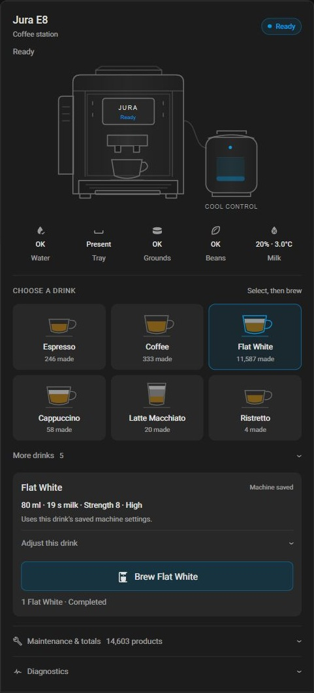
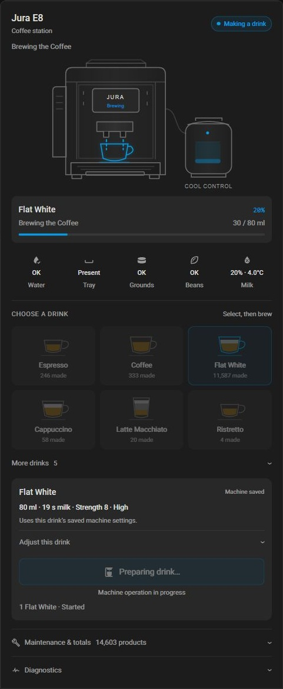
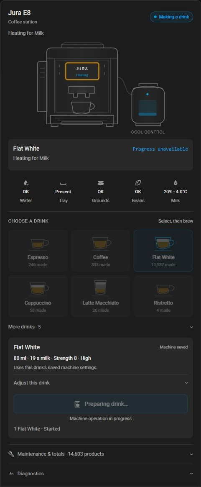
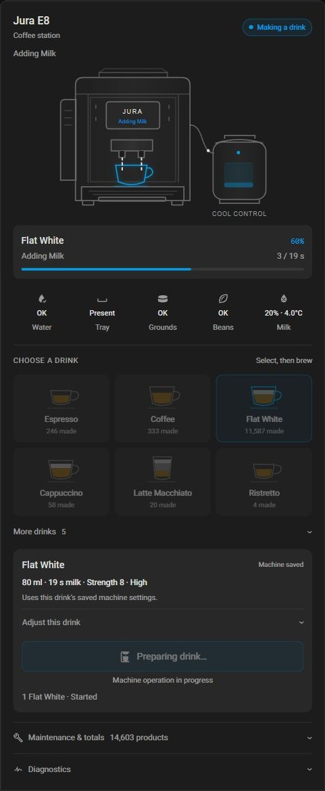

# Jura Graphical Card for Home Assistant

The optional `custom:jura-native-card` dashboard card works with this repository's
`jura_native` ESPHome component. It does not install or update ESPHome firmware.
The legacy `jura` component uses a different entity contract and is not supported
by this card.

## Live screenshots

These are card-only captures from the reference E8/EF533 on 18 October 2026.
The Flat White was started by the owner using the HA card; the captures show
different moments, not simultaneous readings. Counters and settings are examples
from that machine, not defaults for other machines.

| Ready and drink selection | Brewing the coffee |
| --- | --- |
|  |  |

| Heating for milk | Adding milk |
| --- | --- |
|  |  |

## Requirements and compatibility

- Home Assistant with the machine's native ESPHome integration connected.
- `jura_native` entities for status, alerts, drink selection, selected recipe,
  available recipe bounds/choices and observed TV progress. The card was developed
  against component 0.3.0 and tested with subsequent `dev` timeout cleanup.
- Brewing is optional and requires `allow_brew: true` on the ESPHome component.
  See [component configuration](configuration.md) and [saved recipes](saved-recipes.md).
- Cool Control is optional and uses its own ESPHome entities.

The verified setup is E8 / EF533M V02.09. Drinks and supported settings are
discovered from entities and profile options; inclusion of another profile does
not prove physical compatibility. Other profiles need community testing. Use a
current Home Assistant browser; no older minimum HA version has been certified.
The card uses modern CSS including `:has()` and `color-mix()`.

## Install using HACS

Use this route after the card is merged into `main` and the release is published.
The repository is a HACS **custom repository**, not yet a default catalogue entry.

1. Open HACS and its **Custom repositories** menu.
2. Add `https://github.com/tiaanv/jura` as a **Dashboard** repository.
3. Find **Jura Graphical Card** and download it.
4. Refresh the browser. If HA asks to reload dashboard resources, do so.
5. Add a **Manual** card to your dashboard using one of the examples below.

HACS normally registers the dashboard resource. If the card type is unavailable,
check **Settings → Dashboards → Resources** (advanced mode may be needed) for a
single JavaScript module resource:

```text
/hacsfiles/jura/jura-native-card.js
```

An existing HACS-managed URL may have its own version query parameter; keep it.
Do not also register the manually installed `/local/` copy: loading two copies
can leave the older custom element active until a full browser reload.

HACS installs only the card bundle selected by root `hacs.json`. Existing ESPHome
external-component configuration and UART setup are unaffected.

## Manual install, including testing dev

1. Download `dist/jura-native-card.js` from the chosen repository branch or the
   matching `jura-native-card.js` release asset.
2. Copy it into Home Assistant's `/config/www/jura-native-card.js`. Create `www`
   if needed. Do not copy the source-template file from `card/src/`.
3. Add a dashboard resource of type **JavaScript module**:

   ```text
   /local/jura-native-card.js?v=2.1.4
   ```

4. Refresh the browser and add the card YAML.

On manual upgrades, replace the bundle, change the version query parameter and
reload the browser. When moving to HACS, remove the old `/local/` resource first
and let HACS manage the `/hacsfiles/` resource. Keep the existing card YAML.

## Configure the card

Machine without Cool Control:

```yaml
type: custom:jura-native-card
name: Jura E8
entity_prefix: jura_e8
coolcontrol: false
```

With an independently connected Cool Control:

```yaml
type: custom:jura-native-card
name: Jura E8
entity_prefix: jura_e8
coolcontrol:
  level: sensor.jura_coolcontrol_jura_coolcontrol_level
  temperature: sensor.jura_coolcontrol_jura_coolcontrol_temperature
```

Find the real entity IDs in HA's Developer Tools → States or the ESPHome device
page. `entity_prefix` is the shared object-ID prefix, without the entity domain
or trailing underscore. For example, `sensor.kitchen_jura_jura_status` uses
`entity_prefix: kitchen_jura`. Changing the display `name` does not rename entities.

| Option | Default | Meaning |
| --- | --- | --- |
| `type` | Required | `custom:jura-native-card` |
| `name` | `Jura E8` | Card heading; also used when matching friendly counter names. |
| `entity_prefix` | `jura_e8` | Prefix used to construct the machine entity IDs. |
| `coolcontrol` | Enabled | Set `false` to hide the cooler, hose and milk reading; otherwise configure `level` and `temperature`. |
| `entities` | Generated mappings | Overrides for individual logical entity keys. |
| `recipes` | None | Custom recipe tiles; see [custom recipe configuration](card-recipes.md). |
| `hold_to_brew` | `false` | Enable 1.5-second tile holds to prepare and brew; short taps still select. |

There is currently no graphical configuration editor or automatic device picker.
Use YAML. Explicit `coolcontrol: false` is recommended if there is no cooler.

### Custom recipes and hold-to-brew

Personal recipes appear above standard drinks and can override only selected
parameters. Optionally enable a 1.5-second hold to prepare and brew either kind
of tile. See **[configuration, examples and gesture behaviour](card-recipes.md)**.

### Renamed entities

The card generates its entity IDs from the prefix. Override individual IDs if
Home Assistant renamed them, for example:

```yaml
type: custom:jura-native-card
name: Kitchen Jura
entity_prefix: kitchen_jura
coolcontrol: false
entities:
  status: sensor.coffee_machine_status
  connected: binary_sensor.coffee_machine_connected
  drink: select.coffee_machine_drink
  brew: button.coffee_machine_brew
```

Override every affected logical key; overriding one does not rename the others.
The mapping contract is in `setConfig()` in
[`card/src/jura-native-card.js`](../card/src/jura-native-card.js). Common groups:

| Logical keys | Generated entity pattern |
| --- | --- |
| `status`, `status_detail`, `active_alerts`, `current_product`, `progress_state`, `progress`, `stage_current`, `stage_target`, `stage_unit`, `stage_code` | `sensor.<prefix>_jura_<key>` |
| `connected`, `brew_active`, `alerts_stale`, `recipe_loading`, `recipe_modified` | `binary_sensor.<prefix>_jura_<key>` |
| `drink` | `select.<prefix>_jura_drink` |
| `brew`, `reset_recipe`, `refresh` | `button.<prefix>_jura_<key>` |
| `water`, `milk`, `foam`, `bypass`, `pause` | `number.<prefix>_jura_water_amount`, `milk_amount`, `milk_foam_amount`, `bypass_amount`, `milk_pause` respectively |
| `strength`, `temperature`, `grinder` | `select.<prefix>_jura_coffee_strength`, `temperature`, `grinder_ratio` respectively |
| `water_min/max/step` | `sensor.<prefix>_jura_water_min/max/step`; other numeric controls follow the corresponding bound key in source. |
| `water_tank_status`, `tray_status`, `grounds_level`, `changed_counters` | `sensor.<prefix>_<key>` |
| `fill_water`, `insert_tray`, `empty_tray`, `empty_grounds`, `insert_coffee_bin`, `no_beans` | `binary_sensor.<prefix>_<key>` |

Recipe choices, bounds and loading/source entities matter: without them, controls
can be hidden or Brew disabled. The YAML above is a renaming example, not a minimal
list of all required entities. See the [native entity documentation](home-assistant.md).

Drink counters use the same prefix and conventional `<drink>_count` entity names,
with friendly-name matching as a fallback. There is no per-drink counter override
map in this release. Arbitrarily renamed counters may show unavailable.

## Using the card

The steps below describe ordinary taps. With `hold_to_brew: true`, a completed
1.5-second hold prepares and brews automatically; see [hold-to-brew](card-recipes.md#hold-to-brew).

1. Place a suitable cup and check water, beans and the milk supply where needed.
2. Select a graphical drink tile or expand **More drinks**. Selection loads that
   drink's machine-saved recipe; selecting a tile never starts brewing.
3. Optionally expand **Adjust this drink**. Only settings supported by the
   selected profile are shown. Changes apply to the next brew only.
4. Wait for recipe loading to finish, then press **Brew** explicitly.

If the saved-recipe read fails, the card labels profile defaults clearly. Inspect
the settings before brewing. **Reset to saved recipe** reloads machine settings.
The card does not overwrite the machine's saved recipe.

During operation, the panel uses the **observed product**, even if someone started
a different drink at the machine. Flat White stages include **Grinding the
Coffee**, **Brewing the Coffee**, **Heating for Milk**, **Adding Milk**, and
**Your Flat White Is Ready**. Heating uses the generic **Heating Up** unless the
same observed operation's preceding coffee stage establishes its purpose.

Stage quantity and overall progress are separate: `60 / 80 ml` is one stage,
while `40%` is the native overall percentage. Milk/foam quantities are seconds,
not millilitres. When no percentage is supplied (normal during heating or rinsing), the
percentage and progress bar are hidden; the operation message remains visible.
Progress is never estimated from elapsed time. Some machines do not report a terminal frame for every rinse;
fresh Ready status hides retained operation panels. Fresh shutdown status clears
retained coffee-rinse visuals once the explicit rinse flag clears.

The alert banner translates machine shorthand into actions, for example **Rinse
the Milk System**. Ambiguous alerts say **Check the machine display**. Offline
hides cached alerts and dims the machine while preserving independent cooler
readings. During active operations the machine sends TV progress instead of TF
alerts, so the expected stale-alert notice is suppressed while other alert
messages remain visible. During the finishing handoff the stale notice also stays hidden while fresh TF
status is awaited. Outside active/finishing states, stale warnings are shown.
**Offline** means disconnected; it does not prove the machine is in
standby. Raw product/stage/TF/TV readings remain in **Diagnostics**.

The tray reading shows **Full** with an amber icon when emptying is requested,
**Missing** when removed, and **Present** otherwise. Missing takes priority;
stale or unavailable tray readings show a dash.

Unknown stage codes such as `State 0x9A` are retained in Diagnostics. The main
card uses the known operation context, such as **Rinsing the Milk System**,
without assigning an unverified meaning to the substage. With no known specific
operation, it shows **Machine Operation in Progress**.

## Troubleshooting

| Symptom | Check |
| --- | --- |
| Custom element doesn't exist | Resource is JavaScript module, correct URL, browser reloaded, and no duplicate old resource. |
| Card says Offline while device is online | Actual `connected` entity ID and configured prefix; inspect raw States first. |
| Brew disabled | Machine readiness, fresh alerts, `allow_brew`, selected-recipe loading, pending edits or uncertain command. |
| Setting missing | Selected drink's supported bounds/options and entity availability; different profiles differ. |
| No percentage during a stage | Normal when the machine supplies none, such as heating or rinsing. The percentage area is hidden; native data remains in Diagnostics. |
| Duplicate/old visuals after upgrade | Remove old manual resource if using HACS; refresh every open browser/device. |
| Cooler appears without a cooler | Set `coolcontrol: false`. |
| Unknown alert or stage | Unrecognised text is retained; check the machine display and report profile plus raw state, without credentials. |

For a command with an uncertain outcome, check the physical machine before
acknowledging it. Neither the card nor component automatically retries a brew.

## Development and releases

See [card contributing notes](../card/CONTRIBUTING.md). Firmware and card live in
one repository but have separate source folders and version files. The card is
MIT licensed with the repository. HACS distribution requires a public repository;
HACS default-catalogue inclusion is a separate future submission.
