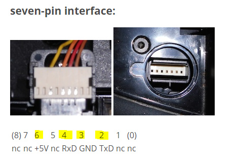

# Hardware and wiring

The reference installation is a Jura E8 / EF533M V02.09 connected to an
ESP32-C3. The ESP is powered by the Jura in this installation. The UART uses
9600 baud, 8 data bits, no parity and one stop bit.

## Signal connections

TX and RX are named from each device's perspective. Cross them and connect the
grounds together. These GPIO numbers match the current E8 example YAML.

| Jura connection | Interface | ESP32-C3 connection |
| --- | --- | --- |
| TX, 0–5 V UART output | 1 kΩ series resistor, then a junction with 2 kΩ to GND | RX, GPIO3, connected to the junction |
| RX, UART input | Direct 3.3 V logic from the ESP on the reference E8 | TX, GPIO4 |
| GND | Common ground, including the bottom of the 2 kΩ resistor | GND |


The wires cross in the drawing between the 2 kΩ resistor and ground without a
junction on the TX wire. Only the marked dots indicate connected junctions.

## Jura TX voltage divider

For the 5 V signal coming **from the Jura into the ESP**, connect:

```text
Jura TX (5 V) ──── [ 1 kΩ ] ────┬──── ESP32-C3 RX (GPIO3)
                                │
                             [ 2 kΩ ]
                                │
                               GND
```

The ESP RX pin connects to the junction of the two resistors. The 2 kΩ resistor
goes from that junction to the shared ground; it is not another series resistor.
Use 1% resistors where possible.

At a nominal 5 V input:

```text
V_RX = 5 V × 2 kΩ / (1 kΩ + 2 kΩ) ≈ 3.33 V
```

ESP32-C3 uses 3.3 V GPIO logic. Espressif specifies a high-level input maximum
of VDD + 0.3 V in the DC characteristics; direct 5 V UART input is outside that
range. See the [official ESP32-C3 datasheet, electrical characteristics](https://documentation.espressif.com/esp32-c3_datasheet_en.html).
This divider assumes a 0–5 V logic-level UART signal. Check the actual signal
voltage on your machine before choosing an interface.

In the other direction, **GPIO4 TX connects directly to Jura RX**: the reference
E8 accepts the ESP's 3.3 V output. That observation is specific to the tested
interface, rather than a guarantee for every Jura model or adapter.

## Connector reference and power

The original project's connector drawing is retained here as a physical
reference. Check the viewing direction and your machine's connector before
connecting wires; the schematic above describes signals, not connector pin numbers.



This is the unchanged [original connector image](https://github.com/user-attachments/assets/6f2bb48f-e853-409c-b768-2b08b87c70d2),
now stored with the documentation so it does not depend on that external image URL.

Power the ESP through an input appropriate to your development board and the
measured supply voltage. A verified regulated 5 V supply belongs on a board's
supported 5 V/VIN input, not its 3V3 pin. Confirm that the supply can support the
board and Wi-Fi operation. A 5 V UART signal alone does not establish the voltage
or available current of a connector's power pin.

The voltage divider only reduces the RX **signal** voltage. It is not a power
regulator, and it does not replace the shared ground connection. This guide does
not assign an unverified power pin to the Jura connector.

## Matching ESPHome YAML

```yaml
uart:
  id: uart_bus
  tx_pin: GPIO4
  rx_pin: GPIO3
  baud_rate: 9600
  rx_buffer_size: 2048

jura_native:
  id: jura_coffee
  uart_id: uart_bus
```

Merge this with the [complete E8 example](../examples/e8.yaml); other pins can
be used if supported by your board and reflected in the YAML. GPIO4/GPIO3 are
the reference C3 choices, not an ESP8266 pin mapping. Keep logger serial output
off the Jura UART pins, and let only `jura_native` consume this bus.

See [configuration](configuration.md) for the native controls and API options.
