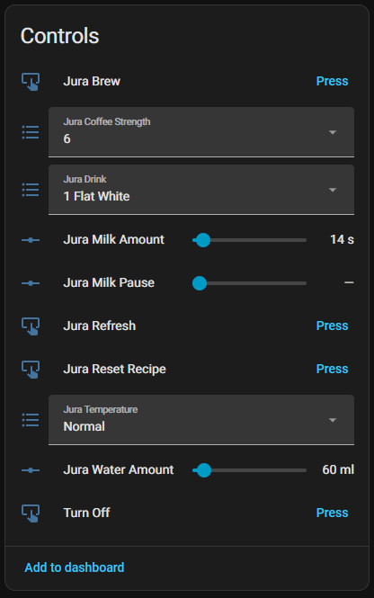
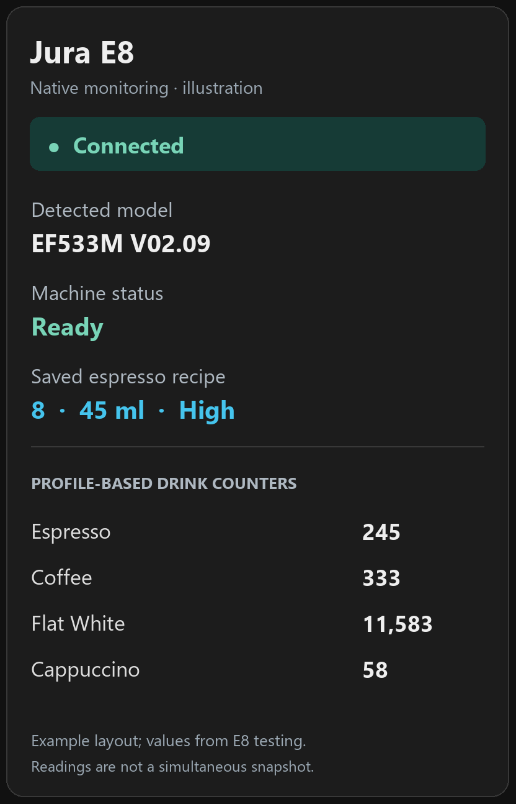

# Home Assistant and card integration

The component uses ESPHome's native API. Native entities are discovered directly;
no MQTT broker or separate custom integration is required. Use the actual entity
IDs discovered under your device; friendly names alone do not guarantee the old
component's IDs or history.

## Device controls and monitoring

| Native controls — user screenshot | Monitoring — illustration |
| --- | --- |
|  |  |

The screenshot is an unmodified image supplied by the project owner during
earlier testing. It predates saved-recipe synchronisation; the displayed Flat
White settings must not be treated as a verified saved recipe. Current controls
load the machine's settings and expose loading/source state as described in
[saved recipes](saved-recipes.md).

The monitoring panel is a documentation illustration, not a supplied dashboard
or a live screenshot. It combines values observed during E8 testing, including
the espresso settings read and profile-based counters. Readiness, recipe and
counter values were not captured simultaneously. It intentionally does not
present the historical raw-register interpretations as verified counters.

During a drink, the component also exposes the current product, progress and
available stage details. A complete live progress screenshot has not yet been
captured for this documentation. Your existing custom card can consume these
entities; no particular card layout is required by the component.

## Define the API actions

Merge the `api.actions` definitions from [examples/e8.yaml](../examples/e8.yaml)
into your existing API block, retaining encryption. They call these C++ methods:

| HA action suffix | Method | Behaviour |
| --- | --- | --- |
| `brew_drink` | `brew_named(drink)` | Freshly read saved recipe for the named drink |
| `brew_custom` | `brew_custom(...)` | Freshly read saved recipe plus explicit overrides |
| `brew_selected` | `brew_selected()` | Currently loaded native controls and their one-shot edits |

If those definitions already exist, updating the V2 component changes their
implementation without requiring new YAML arguments. Confirm the final action
names in HA Developer Tools → Actions. The examples below assume `jura-e8`.
The exact product label for this EF533 is **`1 Flat White`**; labels vary by profile.

## Saved Flat White

Run this action on its own while the machine is ready:

```yaml
action: esphome.jura_e8_brew_drink
data:
  drink: "1 Flat White"
```

## Custom Flat White

Use 60 ml water and keep the other machine-saved settings:

```yaml
action: esphome.jura_e8_brew_custom
data:
  drink: "1 Flat White"
  strength: ""
  water_ml: 60
  milk_seconds: -1
  foam_seconds: -1
  temperature: ""
  bypass_ml: -1
  pause_seconds: -1
  grinder_ratio: ""
```

Send all fields. Numeric `-1` and empty/`default` choice strings inherit saved
values; explicit values override them. Zero is an explicit value, not an omitted
setting. Strength/temperature/grinder choices use displayed profile labels;
strength is not grams. Water/bypass use ml; milk/foam/pause use seconds.
A failed saved-settings read uses a labelled profile-default baseline.

## Brew the selected native controls

Select a drink, wait for Recipe Loading to turn off, edit supported controls,
then press the native **Jura Brew** button using HA's `button.press` action.
If you added the optional API definition, the equivalent is:

```yaml
action: esphome.jura_e8_brew_selected
```

This consumes the selected controls' HA edits for one accepted request. Named
and custom API actions do not take or consume those unrelated UI edits; their
product and custom values are snapshotted at request time. They read a fresh
saved recipe even if the native selector shows a different drink.

API requests are asynchronous: submission is not physical completion. Only one
control request can be pending. Becoming busy/not-ready or disconnecting during
API preparation cancels it; a late reply cannot revive it. Brew commands are
never retried automatically. See [saved recipes](saved-recipes.md).

## Recipe and command state

| Entity | Meaning |
| --- | --- |
| Jura Recipe Source | `Machine` or `Profile defaults` for the native baseline |
| Jura Recipe Status | Waiting, reading, loaded product, or fallback reason |
| Jura Recipe Loading | Disable native Brew while true |
| Jura Recipe Modified | HA edits are pending for the next accepted native Brew request |
| Jura Saved Recipe Raw | Current native selection's raw response (diagnostic) |
| Jura Requested Product | Latest requested brew product |
| Jura Command Result | Queued, reading, sent, started, completed, rejected, cancelled or unconfirmed outcome |
| Jura Command Recipe Source | API baseline: `Pending`, `Machine`, `Profile defaults`, or `Not used` |
| Jura Command Recipe Status | API settings-read, fallback or cancellation detail |
| Jura Command Recipe Raw | API raw settings response (diagnostic) |

Keep native recipe state separate from API command recipe state in the card.
For API calls, check Command Recipe Source to distinguish saved values from a
fallback. Follow Command Result and matching TV product/progress for execution.

## Machine status and alerts

| Entity | Meaning |
| --- | --- |
| Jura Status | `ready`, `busy`, `blocked`, `heating`, `finishing`, `not_ready`, `connecting`, `offline` or `unknown` |
| Jura Status Detail | Stage, blocking reasons or connection detail |
| Jura Connected | Valid AT session traffic is available |
| Jura Alerts Stale | TF is absent or older than 60 seconds |
| Jura Active Alerts | Joined active alert names |
| Profile-labelled alert binary sensors | Individual supported alerts, including maintenance reminders |
| Tray Status | Present, Missing or Unknown |
| Water Tank Status | OK, Fill Tank or Unknown |

Maintenance alerts can be nonblocking: show Active Alerts even when status is
ready. Keep unknown/unavailable visibly different from OK. Separate Cool Control
sensors supply milk level/temperature; the main UART component does not.

## Progress

| Entity | Meaning |
| --- | --- |
| Jura Current Product | Current observed drink/process; `None` when idle, `Unknown` when unavailable |
| Jura Progress State | Grinding, dispensing, finished or another mapped stage |
| Jura Progress | Overall machine-reported percentage, if present |
| Jura Stage Current / Stage Target | Available actual/target values for the current stage |
| Jura Stage Unit | `ml`, `s` or `level`; do not hardcode one unit |
| Jura Brew Active | Operation observed; unavailable if progress times out |
| Jura Product Code / Stage Code | Raw identifiers for investigation |

Stage values are not overall percentages. Unknown channels/stages retain raw
codes without invented quantities. A recognised finish is shown until fresh TF
status returns or the 20-second progress window expires. Progress silence without
a recognised finish clears the current product to `Unknown`, makes Brew Active
unavailable and requests fresh TF status; it does not claim successful completion.
When fresh TF arrives with no active TV operation, Current Product becomes `None`
and Progress State becomes `Idle`. Startup, reconnect and connection loss clear
the product to `Unknown`. Product/stage codes, quantities and percentages are
also cleared when the live operation is cleared; this is not a last-drink history.
An incidental TF frame does not erase an actively tracked TV operation.

## Parameter controls and bounds

Native controls include Drink, Coffee Strength, Temperature, Grinder Ratio,
Water Amount, Milk Amount, Milk Foam Amount, Bypass Amount and Milk Pause,
where applicable. See [configuration](configuration.md#native-controls).

Min/Max/Step sensors exist for Water, Milk, Milk Foam, Bypass and Milk Pause.
Current Strength/Temperature/Grinder Choices are pipe-separated labels (` | `).
Use those current-drink entities to constrain a card's inputs. Native traits
cover the profile-wide union, while every submitted value is checked against
the actual selected drink. Hide unsupported/unavailable controls.

## Counters

The component creates `<drink name> Count`, model-labelled maintenance Count /
Maintenance percentage entities, and Jura Total Products. Product readings use
16-bit base banks; overflow/high-word and daily banks are not implemented.
Unsupported sentinel readings remain unavailable instead of zero.

All inherited raw semantic labels are unverified; do not use them as established
counters or add them to overlapping AT counts. See [diagnostics](diagnostics.md#raw-registers).

## More examples

[examples/ha-actions.yaml](../examples/ha-actions.yaml) contains the three action
payloads above. Run only one document/action at a time and wait for the machine
to finish and become ready before the next brew.
